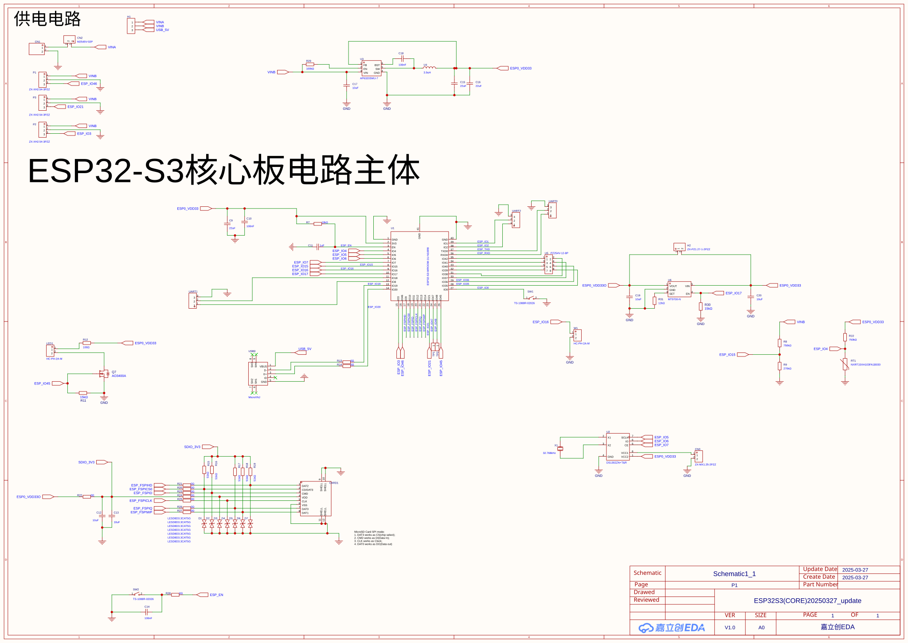
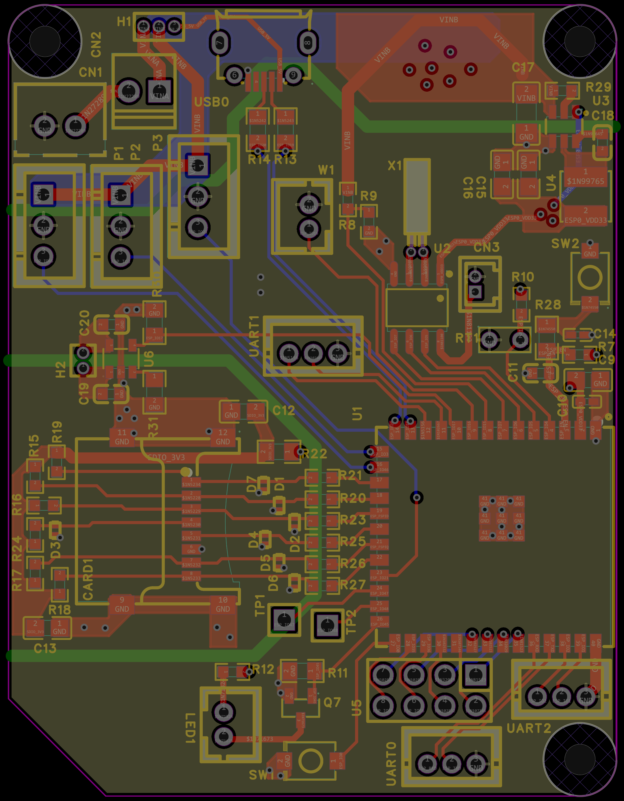
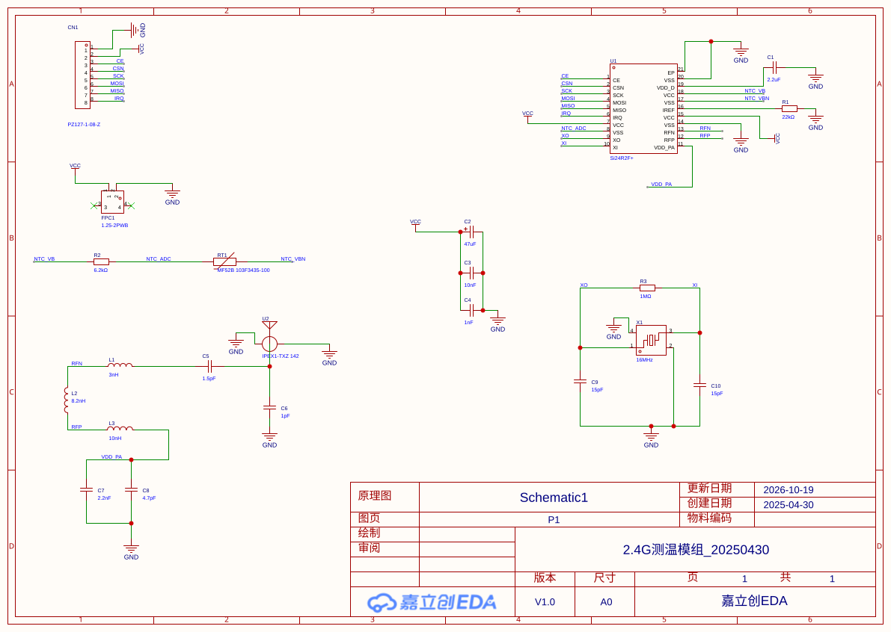
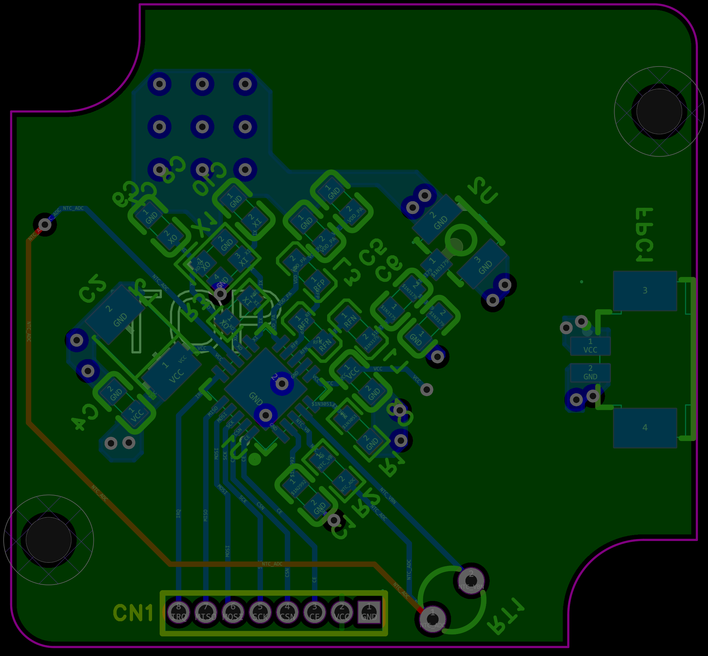
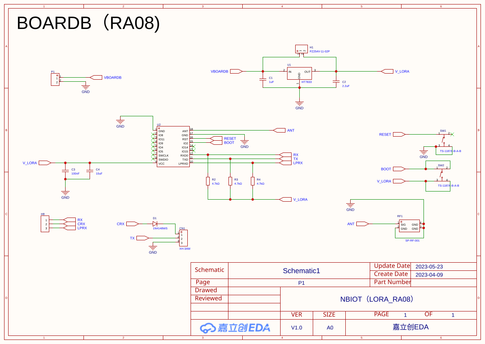
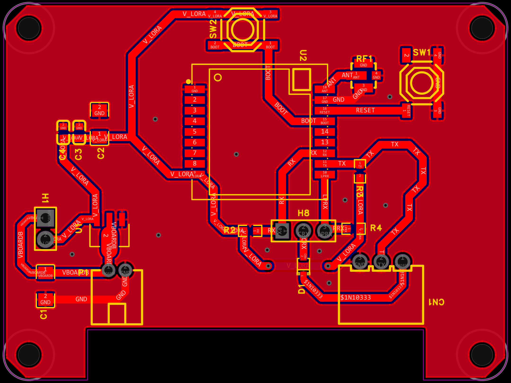
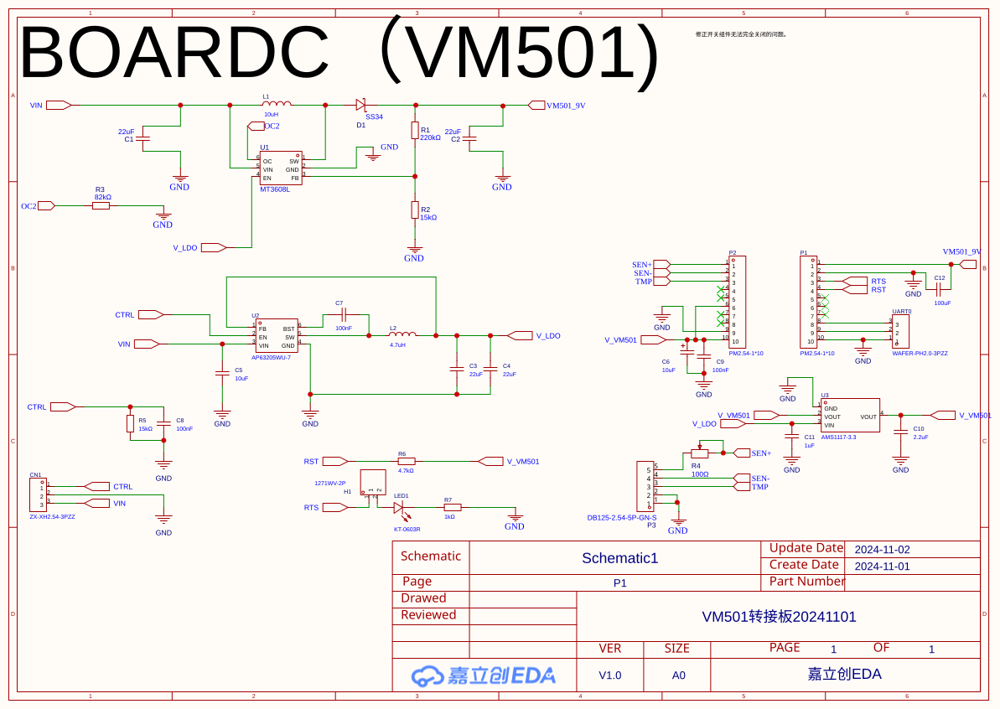
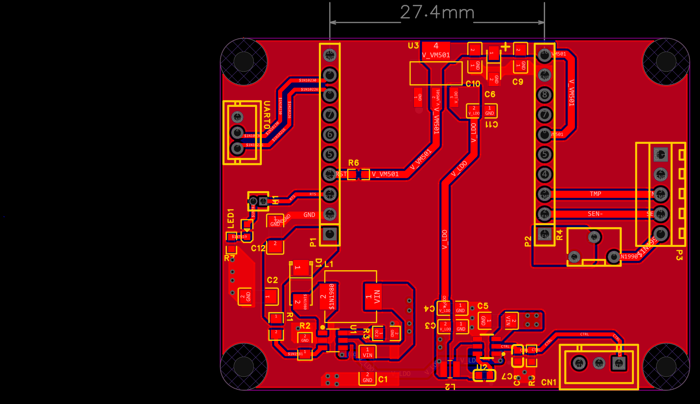

# Case Study: IoT Edge Gateway — BLE to Cloud over 4G

An ESP32-S3 gateway that collects BLE sensor broadcasts, turns them into readings, and ships them to a ThingsBoard server over a 4G modem. It runs where there's no WiFi and often no easy power, so it sleeps almost the whole time and wakes on a timer.

> 🌐 中文版 / Chinese version: [iot-edge-gateway-ble-mqtt.zh.md](iot-edge-gateway-ble-mqtt.zh.md)

---

## Background

A site had a pile of battery-powered BLE sensors but no way to gather or watch them in one place. Wiring each one or giving each its own cellular link wasn't worth the cost. They needed one small box that sits there, picks up the BLE data, and pushes it to the cloud every so often.

---

## Problem

- BLE-only sensors can't reach the network on their own.
- No central view of device status, battery, or last-seen time.
- Manual on-site checks were slow and missed things.
- The box had to run where there's no WiFi and sometimes no easy power.
- A sensor going offline had to be noticed, not silently lost.

---

## Constraints

| Constraint | Detail |
|-----------|--------|
| Power | Battery-fed, so deep sleep with a timer wakeup |
| Cost | One ESP32-S3 + one 4G module covers many sensors |
| Network | 4G only, often flaky; must buffer and retry |
| Field service | Nobody on site to reflash; config and firmware go over the air |
| Scale | Many BLE nodes per gateway, each known by type + MAC |

---

## Solution

```
┌──────────┐ BLE ┌──────────────┐  parse  ┌────────────┐  4G/MQTT  ┌──────────────┐
│ BLE      │────►│ ESP32-S3     │────────►│ ThingsBoard│─────────►│ Cloud dash.  │
│ sensors  │     │ scan+buffer  │         │  (MQTT)    │           │ + alerts     │
└──────────┘     │ + RTC + 4G   │         └────────────┘           └──────────────┘
                 └──────┬───────┘
              deep-sleep│timer wake
                 ┌──────▼───────┐
                 │ FFat ring    │  queue cursors in RTC memory,
                 │ buffer (5)   │  survives sleep + reboot
                 └──────────────┘
```

- **Scan** (`BluetoothScanner`): scans against a whitelist of device types and MACs, kept in Flash. Unknown devices are ignored. It also counts how many times each known MAC went missing, so a dead sensor shows up on the dashboard.
- **Read** (`parseManufacturerData` + NTC table): the BLE manufacturer data becomes a temperature reading through a calibration table.
- **Buffer** (FFat ring buffer, five files `stack1`–`stack5`): results are queued with the read/write cursors stored in `RTC_DATA_ATTR`, so the queue survives deep sleep and reboots. The 4G modem stays off.
- **Batch send** (TinyGSM + ThingsBoard MQTT): only when the queue hits `report_count` does the modem power on, connect, and push every queued reading.
- **Device state**: battery voltage, environment and chip temperature, and boot count go up as client attributes; each reading carries an RTC timestamp.
- **Remote management**: firmware updates arrive over ThingsBoard OTA; `sleep_seconds`, `report_count`, the broker, and the BLE scan parameters all come down as shared-attribute updates. No reflash, no site visit.
- **Field setup**: hold a pin at boot and the device becomes a WiFi AP with a small file browser to drop in `config.json`. After that, everything is remote.
- **Time** (external DS1302 RTC): synced to network time each time the modem connects, with a compiled-time fallback if that fails.

A shortened view of the loop:

```cpp
// illustrative, not the shipped code
std::vector<BLEDeviceInfo> devices = scanner.startScan(scan_interval, scan_window);
if (!devices.empty())
    queue.push(generateTemperatureJson(devices, rtcNow()));

if (queue.size() >= report_count) {     // buffer full → wake the modem
    modem.connect();
    tb.connect(broker, token);
    while (!queue.empty()) tb.sendTelemetry(queue.pop());
    tb.loop();                          // wait for OTA / remote config
}
enterDeepSleep(sleep_seconds);
```

---

## Same base, different sensors and links

This isn't a one-off build. The same ESP32-S3 firmware base has been re-targeted for a few deployments, each time swapping the sensor and the uplink:

| Variant | Sensor | Uplink | Notes |
|---------|--------|--------|-------|
| BLE gateway (this case) | BLE beacons — temperature, etc. | 4G → ThingsBoard MQTT | OTA + web-AP setup |
| Laser rangefinder | laser distance (TTL / 485 / ASCII) | 4G → MQTT | encrypted payload, local WiFi config |
| Vibrating-wire vibration | vibration (vibrating-wire) | 4G → HTTP | SM4 encryption, flash-buffered continuation |
| Vibration | vibration | WiFi → MQTT | BLE + encrypted payload |
| LoRa node | generic sensor | LoRa (RA-08 module) | long-range, low-power link |

What stays the same every time: ESP32-S3 on Arduino, a config file holding the sensor calibration, RTC time, a local storage buffer that survives a dropped link, and a WiFi web page for field setup. Only the sensor driver and the transport client change. That's what gets a new deployment running fast instead of starting over.

Those boards are the physical side of that family — all fabricated through JLCPCB. The ESP32-S3 core board is the reused gateway base; the rest are the sensor or variant nodes it works with.

### ESP32-S3 core board — the gateway

| Schematic | PCB layout |
|-----------|------------|
|  |  |

### BLE sensor board

| Schematic | PCB layout |
|-----------|------------|
|  |  |

### RA-08 LoRa board

| Schematic | PCB layout |
|-----------|------------|
|  |  |

### Vibration board

| Schematic | PCB layout |
|-----------|------------|
|  |  |

---

## Key Technical Decisions

### 1. Buffer in FFat, send in batches when full
The 4G link is the expensive, power-hungry part. Keeping the modem off and only waking it when the queue is full cuts both the data bill and the battery draw. Storing the queue cursors in `RTC_DATA_ATTR` means a reboot mid-cycle doesn't lose data. A dropped connection just delays the next batch.

### 2. Remote config through ThingsBoard, not reflash
These boxes get installed where nobody wants to open them again. Sleep time, scan window, report threshold, even the broker — all come down as shared-attribute updates. The setup pin is only for first provisioning.

### 3. Whitelist by type + MAC, persisted to Flash
Scanning everything and filtering later wastes the short wake window. Matching against a known list at scan time keeps the BLE pass quick, and the missing-device counter is what tells the dashboard which sensor went quiet.

### 4. External RTC synced to network time
Without a clock, batches reaching the server have no time order. The DS1302 syncs to network time on each connect (compiled time as fallback), so every record gets a usable timestamp without GPS or a constant connection.

### 5. Deep sleep as the default state
The modem and most GPIOs power down between cycles; only the scan and, occasionally, the 4G send run. That duty cycle is where the battery life actually comes from — not from any clever radio trick.

---

## What I learned

The interesting part wasn't BLE or MQTT; both are libraries. It was the duty cycle: staying asleep as much as possible, buffering without wearing out flash, and not losing data when the network drops. That's where the battery life and the reliability actually come from.

---

## Tags

`#embedded` `#esp32` `#ble` `#4g` `#mqtt` `#thingsboard` `#iot`
